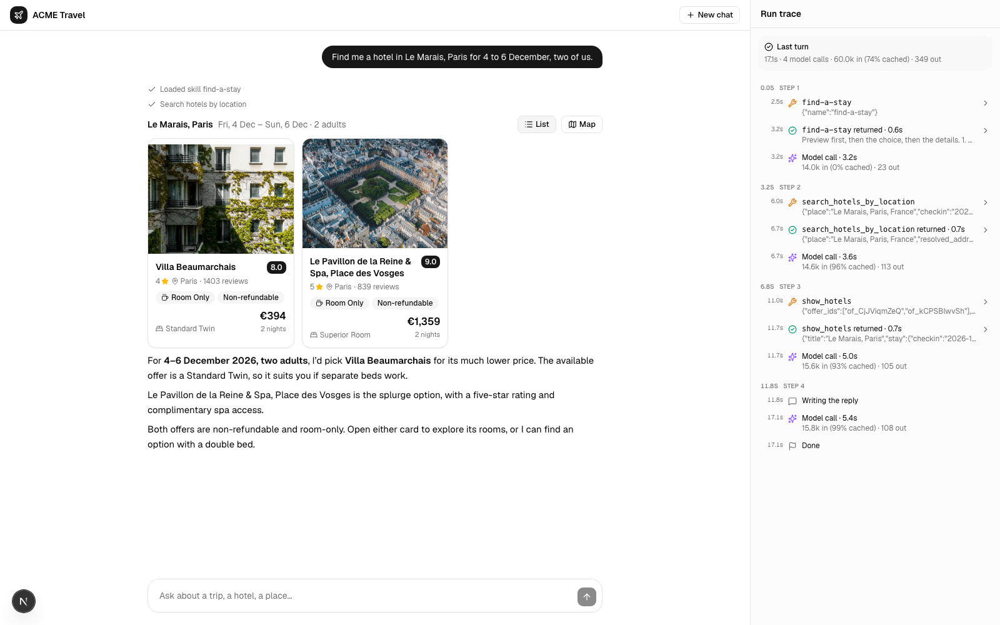
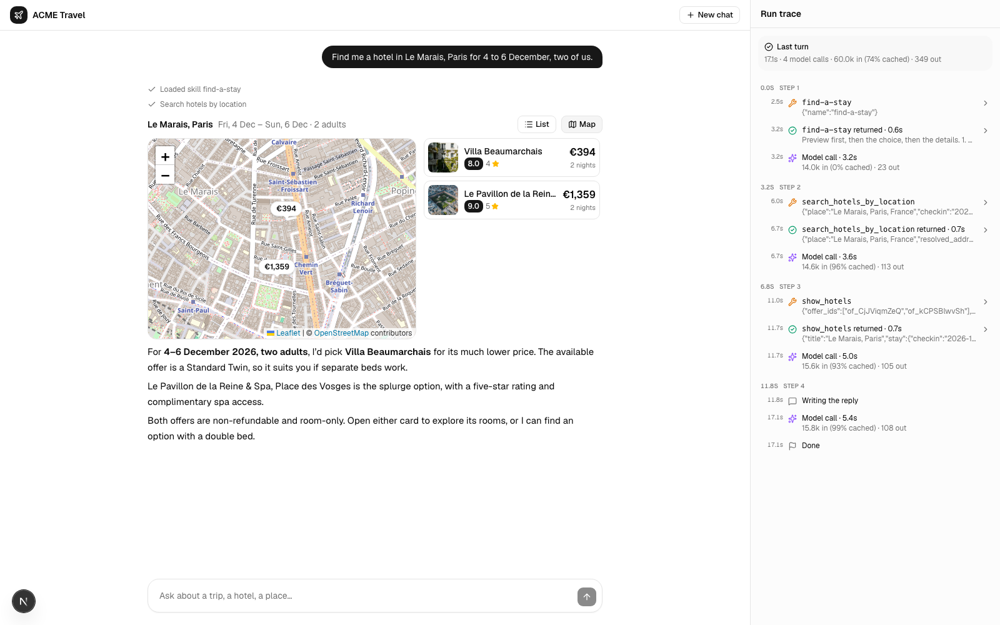
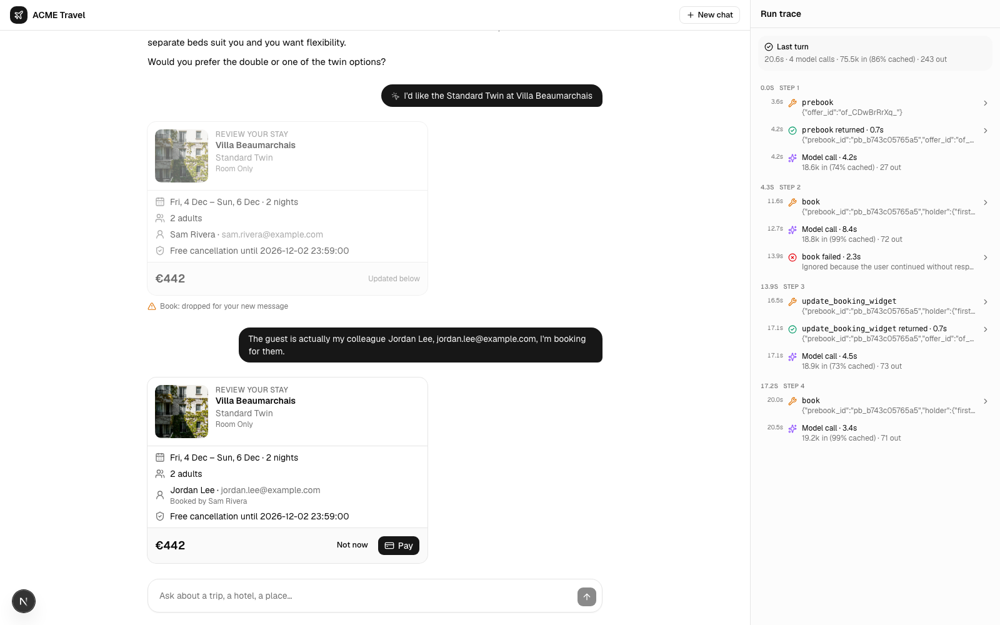
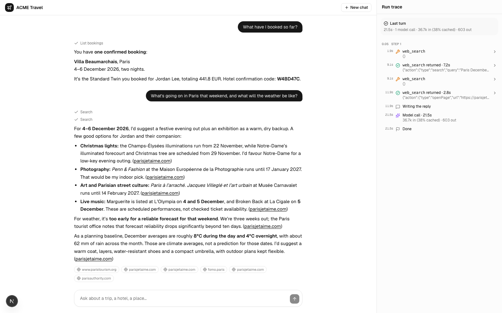

# ACME Travel Agent

An example travel agent for the fictional ACME company, built with [eve](https://eve.dev) (Vercel's framework for durable agents) and a Next.js chat in [shadcn/ui](https://ui.shadcn.com).

The agent searches hotels and shows them as cards and on a map, opens a hotel page with its rooms, prebooks the room you pick into a booking widget, books it when you tap Pay, lists and cancels bookings with a refund, researches the trip on the web with sources, writes itineraries, remembers your preferences across chats, and reads your ACME ride history. A side panel traces each turn: model calls, tokens, and tool calls with their input and output.

It runs on a mocked world out of the box, so all you need is an OpenAI API key.



| Map view | Booking widget | Web research with sources |
| --- | --- | --- |
|  |  |  |

## Quick start

Node 24 and pnpm 10.

```bash
pnpm install
cp apps/agent/.env.example apps/agent/.env.local   # then set OPENAI_API_KEY
pnpm dev                                           # the agent on :3200, the web app on http://localhost:3000
```

Try "Find me a hotel in Le Marais, Paris for 4 to 6 December, two of us", open a card, select a room, tap Pay, then ask it to cancel.

`pnpm build` and `pnpm typecheck` run across the workspace with [Turborepo](https://turborepo.com). `pnpm --filter @acme/agent eval` runs the [evals](apps/agent/evals) against the demo world; they make real model calls.

## Configuration

[apps/agent/.env.example](apps/agent/.env.example) has two keys:

- `OPENAI_API_KEY`: the model, OpenAI's `gpt-6.1-sol` through eve's built-in OpenAI provider, and OpenAI's hosted web search. `AGENT_MODEL` picks another OpenAI model. To use another provider, change `model` in `apps/agent/agent/agent.ts` (see eve's agent configuration docs).
- `NUITEE_API_KEY` (optional): live hotels from [LiteAPI](https://www.liteapi.travel). A `sand_…` sandbox key books test stays for free. Without it, the agent runs in demo mode.

The agent works for one fictional account, Sam Rivera in Warsaw (`packages/travel/src/config.ts`).

## Demo mode

Hotels and bookings run on a mocked world in `packages/travel/fixtures/world.json`:

- **Hotels:** 298 hotels in 10 European cities, recorded from the LiteAPI sandbox, at fixed prices. Search by city, by 39 neighbourhoods (Le Marais, Trastevere, Shoreditch…) or by style.
- **Booking:** a fake supplier for prebook, book, status and cancel. A refundable booking cancels with a full refund.
- **ACME rides:** a month of rides around Warsaw in PLN, generated from today's date. They are always mocked.

Offers, bookings and the supplier's state are JSON files in `data/` (gitignored). Delete it to reset.

## How it works

```text
apps/agent/        @acme/agent: the eve app, the only server
  agent/
    agent.ts           the model: OpenAI
    instructions.md    the system prompt
    skills/            find-a-stay, the playbook for choosing a hotel, loaded on demand
    memory/            traveller, the preferences eve remembers across chats
    channels/eve.ts    eve's session API, with the per-turn context
    channels/hotels.ts GET /acme/v1/hotel-page, the hotel page a card opens
    tools/             one file per travel tool, plus eve's ask_question
    lib/               what the tools share
  evals/             eve evals on the demo world
apps/web/          Next.js + shadcn/ui chat, frontend only
packages/travel/   the LiteAPI client, the JSON store, the demo world
```

- **eve owns the conversation.** The browser talks to the agent with `useEveAgent` from `eve/react`. Next.js rewrites `/eve/v1/*` and `/acme/v1/*` to the agent, so they share an origin. A chat's URL is `/s/<sessionId>`, and a reload replays it from eve.
- **Turn context.** The channel adds `<now>`, `<location>`, `<account>` and `<plans>` to every turn, so the agent resolves dates like "next weekend" against the user's clock.
- **Tools** are plain eve `defineTool`s with zod schemas. Each returns what the UI renders (cards, the booking widget, booking results), and its `toModelOutput` picks the compact JSON the model reads.
- **Pay is an eve approval.** Right after prebook the agent calls `book`, which waits for the user's approval: the widget's Pay button gives it. `cancel_booking` asks the same way, with a confirmation card. A message typed instead drops the waiting call, so a guest change updates the widget first.
- **eve's built-in tools** are on: `web_search` (OpenAI's hosted search), `web_fetch`, `agent` (a copy of itself for side research), and `bash`, `read_file` and `write_file` in a sandbox: Docker locally, Vercel Sandbox when deployed. A file the agent writes, such as an itinerary, shows in the chat. `ask_question` offers choices as buttons.
- **Memory.** The traveller slot keeps lasting preferences, such as breakfast or quiet rooms, across chats: in memory under `eve dev`, in Vercel Blob when deployed.

| Tool | What it does |
| --- | --- |
| `search_hotels_by_location`, `search_hotels_by_query` | Hotels by place or by vibe, with filters for stars, reviews, meals, refundability and price |
| `show_hotels` | Hotel cards with a map, for up to 6 offers |
| `get_hotel_details`, `get_hotel_reviews` | A hotel's rooms and rates; what guests say |
| `prebook`, `update_booking_widget` | The booking widget with the final price and the guest |
| `book`, `get_prebook`, `get_booking`, `list_bookings`, `cancel_booking` | Booking, status and cancellation with refund |
| `get_ride_history` | The user's ACME rides between two dates |

## Limitations

This is an example, not a product:

- **Local only.** The agent's channels accept only `localDev()` callers, so it runs on your machine. Deploying needs real auth in `apps/agent/agent/channels/`, and a database instead of the JSON files.
- **One account**, fixed in code.
- **Restarts.** After restarting `eve dev`, older chats still replay but can't continue, and memory starts empty. Start a new chat, or run `eve dev --resume`.
- **eve 0.90** is a public preview.

## Credits

Demo hotel data comes from the LiteAPI sandbox; photos belong to their hotels. Maps use [OpenStreetMap](https://www.openstreetmap.org/copyright) tiles. The system prompt is adapted from the Muse agent prompts published in asgeirtj/system_prompts_leaks.
